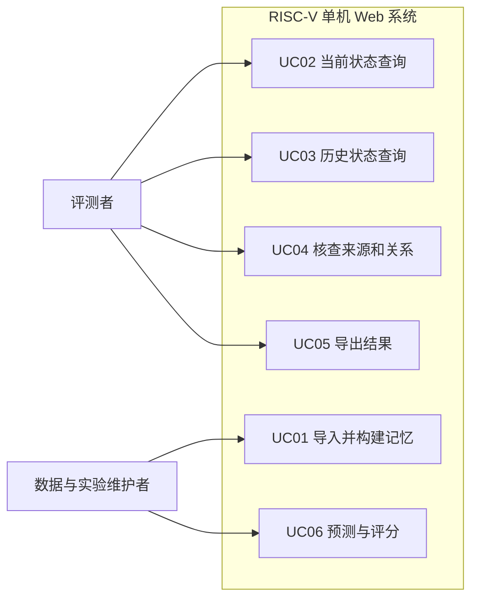
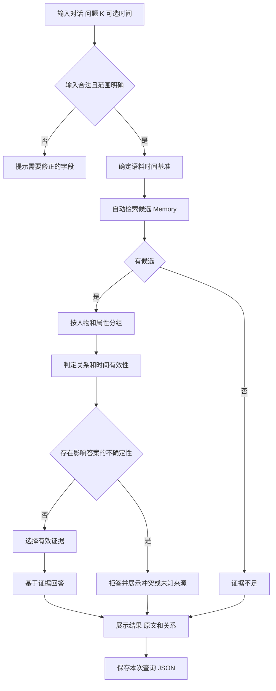
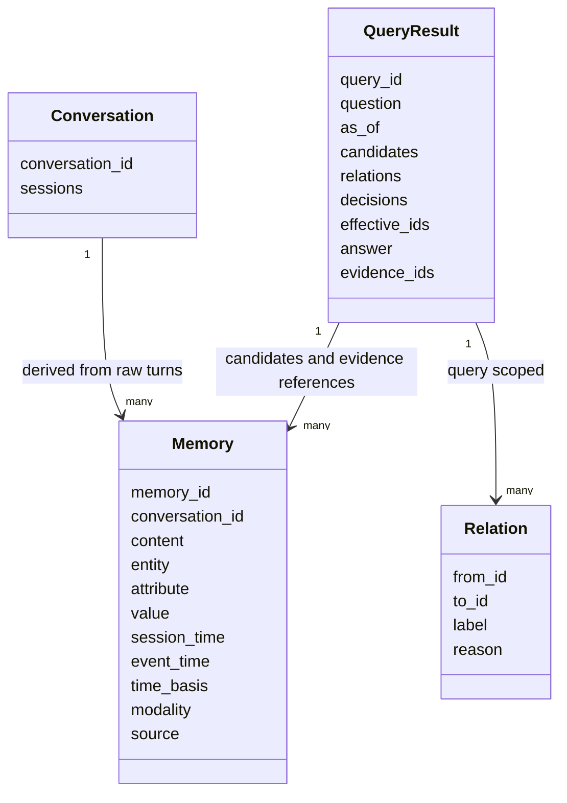
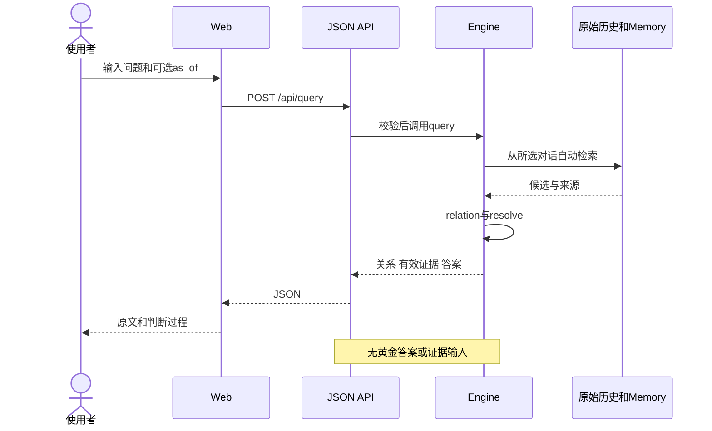
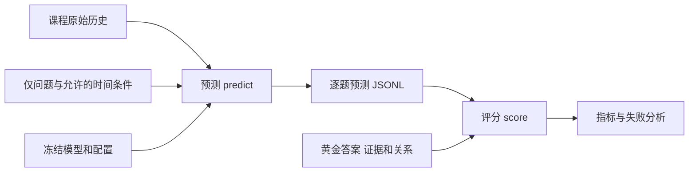
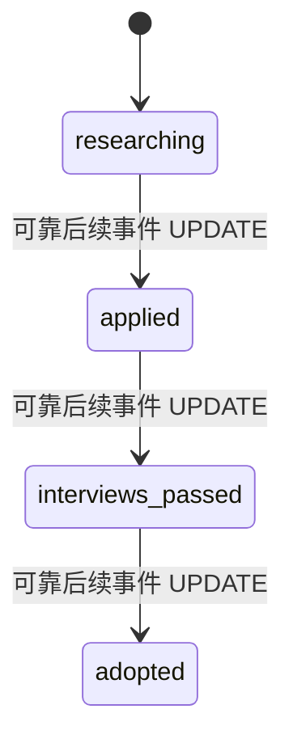

# 需求与设计模型

本文件为可编辑 Mermaid 源图。图中的角色是系统使用者，成员分工见 M1 与计划；黄金标注只进入评分，不进入推理。

## 1 用例边界

## 2 查询活动

## 3 主要数据对象

Memory 本身不含永久 active/inactive。相同 Memory 可以在一次当前查询里是 HISTORICAL，在另一次历史查询里是 EFFECTIVE。

## 4 请求时序与评分隔离

## 5 状态演化示例

该图仅定义收养过程的内部单调阶段，不代表所有现实过程只能单向变化。取消或回退需要额外事件与规则；原型对无解释逆序保守标冲突。SUPERSEDE 用于居住地等单值状态，不用于把不同属性全局归并。
